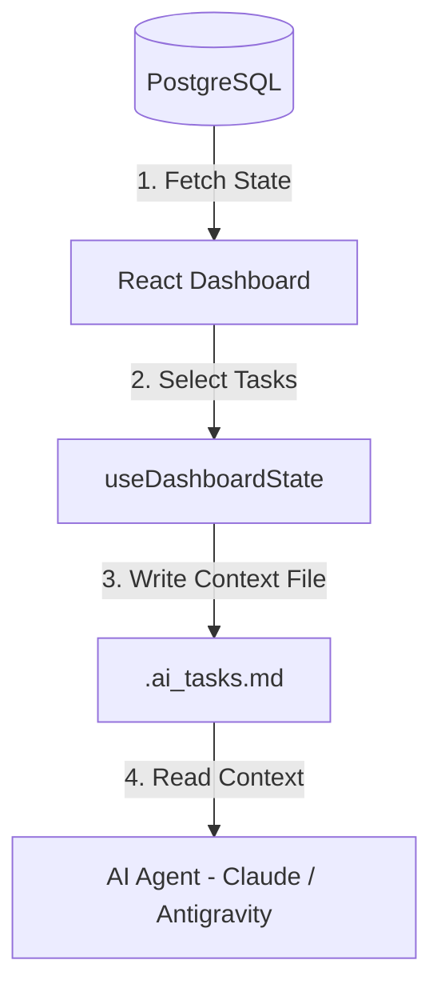

# 🧠 Context Management in the Dashboard

Our dashboard system orchestrates multi-agent operations (Claude Code, Codex, Antigravity, and Aider) on local and remote workspaces. To prevent context drift, token bloat, and conflict during execution, we use a structured **Context-Passing Protocol**.

---

## 🛠️ How Context is Managed

### 1. Dynamic Task Selection & Context Scaffolding
When a user selects tasks in the UI and clicks "Deploy", the dashboard compiles a markdown context file named `.ai_tasks.md` in the root of the target project directory.
* **Completed Tasks**: Prefixed with `[REWORK]` if selected for execution again.
* **Pending Tasks**: Rendered as Standard GFM checklists (`- [ ] task name`).

### 2. Execution Injection
We inject the custom base configuration and API credentials into the agent's environment:
* `ANTHROPIC_BASE_URL` or `OPENAI_API_KEY` are passed dynamically from settings to isolate/direct LLM requests.
* We append specific instruction parameters telling the agent:
  > *"Zrealizuj zadania z pliku .ai_tasks.md. Kiedy skończysz, oznacz je jako wykonane."*

---

## 📐 Best Practices for Workspace Context

1. **Keep `.ai_tasks.md` Atomic**: Keep the scope under 10 tasks to fit within the agent's fast working memory.
2. **Post-Execution Cleanup**: Once the agent completes its run, it updates the task status in the workspace, which can then be re-scanned by the dashboard's `/api/analyze` analyzer.
3. **Environment Isolation**: The agents run inside isolated terminal child processes (`node-pty`) to protect the master dashboard host environment.
