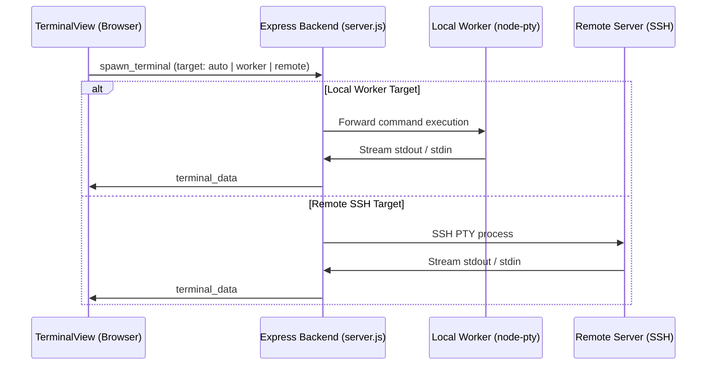

# Dashboard Architecture Documentation

Technical architecture reference for the Dashboard application. For visual diagrams, see [C4 Architecture](C4_ARCHITECTURE.md).

## System Design
The application is structured as a modular full-stack application:
- **Client**: React 19 SPA bundled with Vite, styled with Tailwind CSS v4, communicating via HTTP API and Socket.io.
- **Server**: Express 5 application hosting domain routers and managing real-time terminal streaming.
- **Database**: PostgreSQL with connection pooling (`src/backend/db.js`) and transparent in-memory fallback.

## Domain Module Organization (`src/backend/`)
Each domain isolates its business logic, database queries, and route handlers:
- **`auth/`**: User registration, login, JWT issuance, and `authMiddleware`.
- **`servers/`**: Remote SSH server registry, credential encryption (AES-256), and system resource monitoring (CPU, RAM, Disk).
- **`llmServers/`**: LLM provider configurations (OpenAI, Anthropic, Ollama, LM Studio), API keys, and model parameters.
- **`projects/`**: Project tracking, task extraction from markdown files, and workspace management.
- **`git/`**: Git operations service (`gitService.js`) handling branches, diffs, staging, commits, and remotes.
- **`agents/`**: AI CLI agent configurations (`cli_agents` table) and local worker registrations (`/api/agents/workers`).
- **`widgets/`**: Custom shell command widgets (`custom_widgets` table) and periodic polling execution.
- **`settings/`**: Encrypted user settings and global parameters.
- **`utils/`**: Centralized cryptographic primitives (AES-256-CBC) and formatting helpers.

## Real-Time Architecture (Terminal & Workers)

## Security Architecture
- **JWT Authentication**: Bearer tokens verified on all protected API routes and WebSocket connections.
- **At-Rest Secret Encryption**: SSH credentials, private keys, and API tokens are encrypted with AES-256-CBC before storage.
- **Process Isolation**: Terminal commands run in separate pseudo-terminal processes (`node-pty`) or SSH sessions.
- **Safe Database Queries**: All queries execute through `safeQuery()` parameterization to prevent SQL injection.
