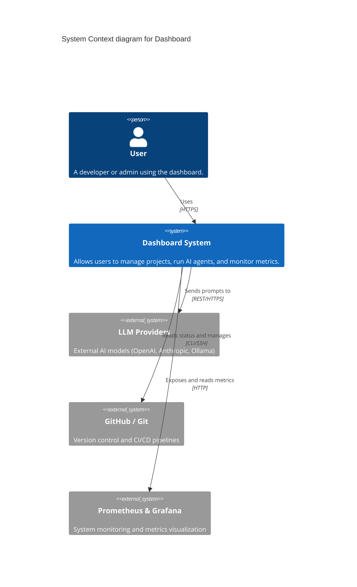
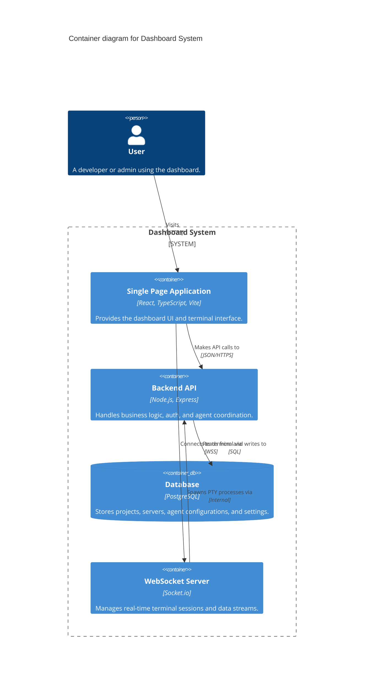

# C4 Architecture Documentation

This document provides a visual representation of the Dashboard system architecture using the C4 model.

## 1. System Context Diagram

This diagram shows the Dashboard in the context of its users and external systems.



## 2. Container Diagram

This diagram zooms into the Dashboard System, showing the high-level technical containers.



## 3. Component Diagram (Backend API)

This diagram zooms into the Backend API container.

```mermaid
C4Component
    title Component diagram for Backend API

    ContainerBoundary(api, "Backend API") {
        Component(auth, "Auth Router", "Express Router", "Handles JWT authentication and middleware.")
        Component(projects, "Projects Router", "Express Router", "Manages project CRUD, Git ops, and task analysis.")
        Component(agents, "Agents Router", "Express Router", "Manages AI CLI agents and terminal deployments.")
        Component(db_module, "Database Module", "pg Pool", "Handles PostgreSQL connections and queries.")
    }

    Rel(projects, db_module, "Uses")
    Rel(agents, db_module, "Uses")
    Rel(auth, db_module, "Uses")
```
