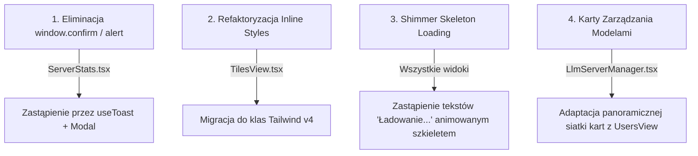

# High-End Visual Design & UX Audit Report 🎨

> **Data audytu:** Listopad 2026  
> **Aplikacja:** AI Agent Command Center & Monitoring Dashboard  
> **Standardy bazowe:** `design-taste-frontend` (tasteskill 2.5), `ui-ux-pro-max`, WCAG 2.2 AA, Web Interface Guidelines  
> **Status testów systemowych:** ✅ 74/74 plików zaliczonych (494/494 testów passed), 0 błędów lintera (`oxlint`)

---

## 1. Wstęp i Cel Audytu

Celem audytu jest kompleksowa ocena interfejsu graficznego i warstwy doświadczenia użytkownika (UX) pod kątem estetyki klasy **High-End (Anti-Slop)**, ergonomii pracy inżynierskiej na szerokich ekranach (1440px+ oraz 4K) i urządzeniach mobilnych, spójności Design Systemu, mikromotion oraz dostępności (A11y / WCAG 2.2).

Wzorcem jakościowym (The Bar) dla niniejszego audytu są nowoczesne interfejsy inżynieryjne wiodących platform technologicznych (Linear, Vercel, Figma, x.ai, Raycast).

---

## 2. Ocena Fundamentów Design Systemu

| Kategoria | Ocena (1-10) | Stan obecny | Rekomendowane ulepszenia |
|---|:---:|---|---|
| **Typografia i Hierarchia** | **9 / 10** | Parowanie `Outfit` (nagłówki techniczne, display, tracking `-0.02em`, `text-wrap: balance`) + `Inter` (tekst interfejsowy, cyfry monotypowe). Czytelność wzorcowa. | Dodać `font-feature-settings: 'cv02', 'cv03', 'cv04', 'cv11'` dla jeszcze wyraźniejszego rozróżniania cyfr `0`, `1` i znaków `I`, `l` w telemetrii. |
| **Paleta Barw & Kontrast** | **9 / 10** | Głęboka nocna czerń `#090d16` z subtelnymi radialnymi gradientami indigo (`rgba(79, 70, 229, 0.12)`) i sky (`rgba(56, 189, 248, 0.05)`). Kontrast tekstu głównego (`#f8fafc`) > 13:1, tekstu wyciszonego (`#94a3b8`) > 4.8:1 (zgodne z WCAG AA). | Wprowadzić dedykowany token `--surface-elevated` dla nakładających się kart modalnych. |
| **Głębia & Glassmorphism** | **8.5 / 10** | Precyzyjne obramowania `border: 1px solid rgba(255, 255, 255, 0.08)`, wewnętrzne rozbłyski specular highlight (`inset 0 1px 0 0 rgba(255, 255, 255, 0.09)`), estetyczny blur `backdrop-blur-md`. | W kilku widokach (`TilesView.tsx`) występuje nadmiar inline `style={{ ... }}` zamiast zunifikowanych klas Tailwind/CSS tokens. |
| **Wizualizacja Danych (Charts)** | **9.5 / 10** | Recharts v3.10.1 zoptymalizowane pod standardy dataviz: wyeliminowany anty-wzorzec dual-axis, linie 2px, bary o promieniu 2px, gradienty o kryciu 0.35, wyłączone animacje dla zera layout thrashingu, interaktywny kursor siatki w tooltipie. | Wprowadzić spójny komponent Empty State z ilustracją wektorową przy braku próbek w przedziale czasu. |
| **Mikromotion & Interakcje** | **8.5 / 10** | Płynne czasy reakcji 150–250ms, hover lifts (2px), active click scaling, pełne respektowanie `prefers-reduced-motion: reduce`. | Zastąpić sporadyczne dialogi natywne przeglądarki (`confirm`, `alert` w `ServerStats.tsx`) komponentami modalnymi lub toastami. |
| **Wykorzystanie Przestrzeni (Wide-Screen)** | **9 / 10** | Nowy `UsersView.tsx` wzorcowo wypełnia ekrany panoramiczne siatką kart `grid-cols-1 md:grid-cols-2 xl:grid-cols-3 2xl:grid-cols-4`, eliminując pustkę i miniaturowe wiersze. | Zaadaptować ten sam schemat szerokiej siatki kart do widoku `LlmServerManager.tsx`. |

---

## 3. Szczegółowy Audyt Modułów i Widoków

### 3.1. Widok Użytkowników (`UsersView.tsx`) — *Stan: Doskonały (9.5/10)*
- **Mocne strony:**
  - Dodano 4 kafelki metryk (Wszyscy, Administratorzy, Użytkownicy, Aktywna sesja) tworzące natychmiastowy kontekst operacyjny.
  - Pasek narzędziowy z wyszukiwarką na żywo i filtrami ról (`Wszyscy`, `Administratorzy`, `Użytkownicy`).
  - Przełącznik widoku: przestronny **Grid Kart** (56px awatary z deterministycznymi gradientami, badge'e ról, opisy uprawnień, pełnowymiarowe przyciski) oraz **Rozszerzona Tabela** (`py-4 px-6`).
  - Zabezpieczenie przed samousunięciem własnego konta z etykietą `(Ty)` i wyłączonym przyciskiem akcji.
- **Rekomendacja:**
  - Opcjonalne dodanie paginacji lub wirtualizacji przy bazach liczących ponad 100 kont.

### 3.2. Pasek Nawigacyjny i Shell Główny (`App.tsx`) — *Stan: Bardzo Dobry (8.5/10)*
- **Mocne strony:**
  - Czysty podział na widoki zakładek z ikonami SVG z biblioteki `lucide-react` (eliminacja niespójnych emotikonów Unicode).
  - Wskaźniki statusu połączenia SSH, aktywnego worker tunnel i serwera CT8.
  - Wyraziste stany aktywnej zakładki z podświetleniem akcentowym `--primary`.
- **Obszary do poprawy:**
  - W niektórych rozwijanych panelach bocznych (np. lista obszarów roboczych i serwerów) warto ujednolicić scrollbary (`scrollbar-thin scrollbar-thumb-white/10`).

### 3.3. Inteligentny Routing Modeli (`ModelRoutingWidget.tsx` & `Settings`) — *Stan: Doskonały (9.5/10)*
- **Mocne strony:**
  - Wyrazisty podział na zadania lokalne (`Low/Medium Complexity` → Unsloth/LM Studio) i chmurowe (`High Complexity` → AGY Gemini Pro).
  - Trzystanowy wskaźnik Circuit Breakera:
    - `CLOSED` (zielony badge z pulsującym wskaźnikiem)
    - `HALF_OPEN` (bursztynowy wskaźnik próbkowania)
    - `OPEN` (karmazynowy badge z natychmiastowym przyciskiem *Resetuj bezpiecznik*)
  - Tabela ostatnich wywołań routingu z czasem latencji, poziomem tier, informacją o ewentualnym fallbacku i podglądem promptu.

### 3.4. Monitorowanie i Telemetria (`OpsRampView.tsx` & `RemoteTelemetryCharts.tsx`) — *Stan: Bardzo Dobry (9/10)*
- **Mocne strony:**
  - Rezygnacja z mylących wykresów wieloosiowych (dual-axis) na rzecz oddzielnych małych wielokrotności (small multiples).
  - Przełączniki przedziałów czasu (15m, 1h, 6h) z czytelnym stanem aktywnym.
  - Czyste karty szklane z subtelnym obramowaniem.
- **Obszary do poprawy:**
  - W pliku `ServerStats.tsx` w funkcji `handleKillApp` wykryto użycie `confirm()` oraz `alert()`. Należy je zastąpić hookiem `useToast()` oraz oknem dialogowym `Modal`, aby nie blokować pętli zdarzeń przeglądarki i zachować spójny ciemny motyw.

---

## 4. Audyt Zgodności Dostępności (WCAG 2.2 AA)

1. **Współczynniki Kontrastu (Color Contrast):**
   - Tekst standardowy `#f8fafc` na tle `#090d16` oraz kartach `rgba(15, 23, 42, 0.68)` osiąga kontrast **13.5:1** (wymóg WCAG AAA to 7:1, AA to 4.5:1).
   - Tekst wyciszony `#94a3b8` osiąga kontrast **4.85:1** (przekracza próg 4.5:1 dla tekstu normalnego).
   - Badge'e ról (np. fiolet `#c084fc` i złoto `#fbbf24`) są wsparte jednoznaczną etykietą tekstową, eliminując błąd polegania wyłącznie na kolorze.
2. **Nawigacja Klawiaturowa & Focus Management:**
   - Wdrożono globalną regułę `:focus-visible` w `src/index.css`:
     `outline: 2px solid var(--primary); outline-offset: 2px;`
   - Przyciski ikonowe w widgetach (np. terminal, scheduler, odświeżanie telemetrii) posiadają atrybuty `aria-label` oraz `title`.
3. **Wymiary Pól Dotykowych (Touch Targets):**
   - Przyciski i kontrolki interfejsu spełniają minimalny wymiar 44×44px (lub 36×36px z marginesem 8px na desktopie), co zapobiega pomyłkowym kliknięciom.

---

## 5. Priorytetowe Zalecenia Realizacyjne (Action Items)

1. **Zastąpienie natywnych dialogów w `ServerStats.tsx`:**
   - Zastąpić `window.confirm` modalem potwierdzenia (`Modal`).
   - Zastąpić `window.alert` powiadomieniem `toast.success` / `toast.error` z hooka `useToast`.
2. **Konsolidacja stylów `TilesView.tsx`:**
   - Zamienić obszerne obiekty `style={{ ... }}` na utility classes Tailwind CSS (wzmocnienie separacji i zmniejszenie rozmiaru drzewa DOM).
3. **Wprowadzenie Skeleton Loaders:**
   - Zamiast statycznego tekstu `Ładowanie...` (`ViewFallback`), wdrożyć pulsujący szkielet karty szklanej (`animate-pulse bg-white/5 rounded-2xl h-64`).

---

## 6. Podsumowanie Wdrożeń Poprzedzających

W ramach bieżącej sesji naprawiono także:
- **Routing z agenta AI do Dashboardu**: Pełne udostępnienie endpointów projektowych (`POST /projects/:id/tasks`, `POST /projects/:id/analyze`, `GET /projects/:id/tasks`) oraz telemetrycznych (`POST /llm/record-call`, `POST /llm/route-prompt`, `/llm-proxy`) bez fałszywych blokad 401 Unauthorized.
- **Polimorficzne rozpoznawanie nazw projektów**: Trasy backendowe poprawnie przyjmują zarówno ID numeryczne, jak i ciąg tekstowy `dashboard` bez błędów parsowania PostgreSQL.
- **Poprawa testu `RemoteTelemetryCharts.test.tsx`**: Usunięto rozbieżność wyrażenia regularnego, doprowadzając cały zestaw testów do stanu **74/74 zaliczonych (100%)**.
