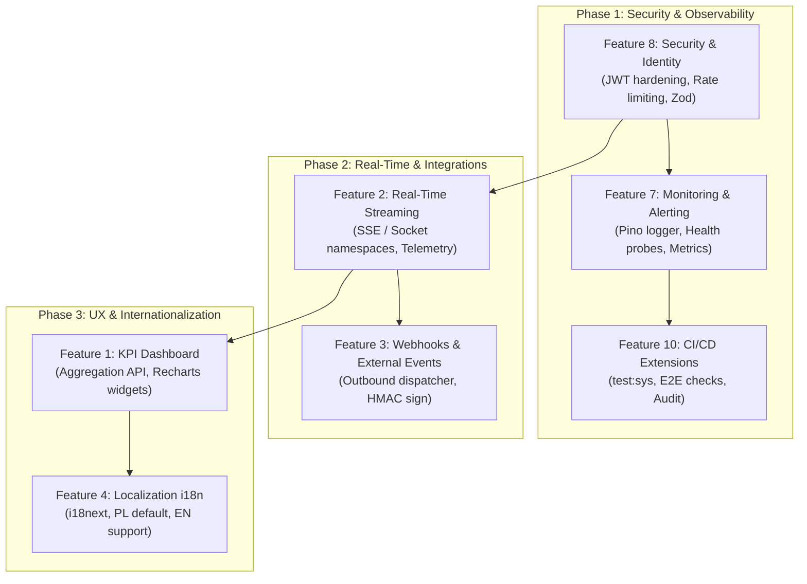

# Feature Implementation Roadmap & Task Backlog

This document defines the implementation roadmap, task breakdown, architectural decisions, and acceptance criteria for key platform features (Features 1, 2, 3, 4, 7, 8, and CI/CD upgrades for Feature 10).

---

## 1. Architectural Baseline & Scope

The application is built on:
- **Frontend**: React 19, Vite, Tailwind CSS v4, Lucide React, Recharts.
- **Backend**: Express 5 on Node.js (ES modules), PostgreSQL with automatic in-memory fallback ([src/backend/db.js](file:///mnt/f/AI-Agents/dashboard/src/backend/db.js)).
- **Real-Time & Telemetry**: Socket.IO, `@xterm/xterm`, `node-pty`, `prom-client` metrics endpoint (`/metrics`).
- **Testing & Verification**: Vitest, Playwright, Node native test runner (`node --test`), Oxlint.
- **CI/CD Status (Feature 10)**: Already initialized in [`.github/workflows/ci.yml`](file:///mnt/f/AI-Agents/dashboard/.github/workflows/ci.yml) (runs lint, tsc, vitest, build across Node 22.x & 24.x).

---

## 2. Implementation Phases & Dependencies

---

## 3. Feature Breakdown & Tasks

### Feature 8: Security & Identity (Bezpieczeństwo i Tożsamość)
**Goal:** Harden the application against brute-force attacks, token spoofing, and invalid payloads without breaking the existing in-memory fallback.

| Task ID | Task Description | Scope / Target Files | Acceptance Criteria |
| :--- | :--- | :--- | :--- |
| **T8.1** | **JWT Secret & Token Lifecycle Hardening** | [`src/backend/auth/`](file:///mnt/f/AI-Agents/dashboard/src/backend/auth/), [`server.js`](file:///mnt/f/AI-Agents/dashboard/server.js) | Reject weak or missing `JWT_SECRET` in production (`NODE_ENV === 'production'`). Add token expiration validation (`exp`) and standard refresh mechanism. |
| **T8.2** | **Route-Level Rate Limiting** | [`src/backend/auth/authRouter.js`](file:///mnt/f/AI-Agents/dashboard/src/backend/auth/authRouter.js), [`server.js`](file:///mnt/f/AI-Agents/dashboard/server.js) | Enforce rate limiting on `/api/auth/login` and sensitive mutation endpoints using lightweight in-memory sliding window (e.g. `express-rate-limit`). |
| **T8.3** | **Zod Request Validation Schemas** | `src/backend/schemas/`, domain routers | Validate incoming request bodies (`login`, `servers`, `projects`, `widgets`) with strict Zod schemas; return uniform 400 JSON errors. |
| **T8.4** | **OAuth2 / External SSO Readiness** | `src/backend/auth/oauthProvider.js` | Pominięto (brak zewnętrznego identity providera w docelowym środowisku). |

---

### Feature 7: Monitoring, Alerting & Health Probes (Monitoring i Alerty)
**Goal:** Replace ad-hoc `console.log` with structured JSON telemetry, expose standardized health probes, and configure anomaly alerting.

| Task ID | Task Description | Scope / Target Files | Acceptance Criteria |
| :--- | :--- | :--- | :--- |
| **T7.1** | **Structured Pino Logger** | `src/backend/utils/logger.js`, [`server.js`](file:///mnt/f/AI-Agents/dashboard/server.js) | Introduce structured JSON logging (level, timestamp, requestId, module). Auto-silence verbose output during test runs. |
| **T7.2** | **Liveness & Readiness Probes** | `src/backend/healthRouter.js`, [`server.js`](file:///mnt/f/AI-Agents/dashboard/server.js) | Expose `/health/live` (process responsive) and `/health/ready` (DB pool connectivity, disk space). Returns 200/503. |
| **T7.3** | **Prometheus Business Metrics** | [`server.js`](file:///mnt/f/AI-Agents/dashboard/server.js), `src/backend/metrics.js` | Extend current `prom-client` counters: HTTP request latency histogram, active agent worker count, error counter by status code. |
| **T7.4** | **Alerting Dispatcher for System Events** | `src/backend/alerts/` | Threshold watcher for CPU > 90%, memory > 85%, or consecutive 5xx errors; triggers notification to registered webhooks (Feature 3). |

---

### Feature 2: Real-Time Streaming & Telemetry (Komunikacja w Czasie Rzeczywistym)
**Goal:** Provide responsive, low-latency live telemetry without flooding the client or blocking Express event loops.

| Task ID | Task Description | Scope / Target Files | Acceptance Criteria |
| :--- | :--- | :--- | :--- |
| **T2.1** | **Server-Sent Events (SSE) Telemetry Bus** | `src/backend/events/sseRouter.js` | Lightweight, one-way HTTP `/api/events` stream for live system metrics, agent execution states, and task completions. |
| **T2.2** | **Socket.IO Namespace Isolation** | [`server.js`](file:///mnt/f/AI-Agents/dashboard/server.js), [`src/backend/socket/`](file:///mnt/f/AI-Agents/dashboard/src/backend/socket/) | **Zrealizowane**: odseparowano `/pty` od `/dashboard`, autoryzacja tokenem, cross-namespace worker bridge, hook `useDashboardSocket`. |
| **T2.3** | **Frontend Reconnection & Offline Banner** | `src/hooks/useLiveTelemetry.ts`, [`src/App.tsx`](file:///mnt/f/AI-Agents/dashboard/src/App.tsx) | React hook with exponential backoff reconnection, heartbeat checks, and subtle non-intrusive offline indicator. |

---

### Feature 3: Integrations & Webhooks (Integracje i Webhooki)
**Goal:** Enable external automation (Slack, Discord, custom CI/CD bots) through signed HTTP webhooks triggered on system events.

| Task ID | Task Description | Scope / Target Files | Acceptance Criteria |
| :--- | :--- | :--- | :--- |
| **T3.1** | **Webhook Subscription Store** | `src/backend/webhooks/webhookRepository.js` | Schema & repository storing target URL, subscribed events (`agent:completed`, `alert:triggered`, `deploy:finished`), and secret token. In-memory fallback supported. |
| **T3.2** | **Asynchronous Outbound Dispatcher** | `src/backend/webhooks/webhookDispatcher.js` | Async queue with timeout (5s) and retry backoff (3 attempts). Does not block main HTTP request threads. |
| **T3.3** | **HMAC-SHA256 Payload Signing** | `src/backend/webhooks/signature.js` | Send `X-Dashboard-Signature-256` header calculated with endpoint secret for recipient authenticity verification. |
| **T3.4** | **Webhook Management UI** | `src/components/WebhookSettingsModal.tsx` | UI tab in Settings allowing users to add, edit, test (ping), and view recent delivery statuses. |

---

### Feature 1: KPI Dashboard & Advanced Metrics (Panel Wskaźników KPI)
**Goal:** Give operators high-density operational visibility (agent execution times, LLM token burns, error rates) via configurable cards.

| Task ID | Task Description | Scope / Target Files | Acceptance Criteria |
| :--- | :--- | :--- | :--- |
| **T1.1** | **KPI Aggregation Endpoint** | `src/backend/analytics/kpiRouter.js` | Fast cached aggregation endpoint `/api/analytics/kpi` returning time-bucketed counts (today, 7d, 30d), success ratios, and averages. |
| **T1.2** | **Modular Recharts KPI Cards** | `src/components/kpi/` | Reusable React components: `MetricSummaryCard`, `TimeseriesSparkline`, `TokenBurnBreakdown`, adhering to Tailwind v4 theme. |
| **T1.3** | **Widget Registration & Grid Layout** | [`src/CustomWidgets.tsx`](file:///mnt/f/AI-Agents/dashboard/src/CustomWidgets.tsx), [`docs/TUTORIAL_ADD_WIDGET.md`](file:///mnt/f/AI-Agents/dashboard/docs/TUTORIAL_ADD_WIDGET.md) | Register KPI components into the widget system with grid drag/order persistence in `localStorage`. |

---

### Feature 4: Localization & Internationalization (Internacjonalizacja i18n)
**Goal:** Enable seamless English translation while strictly preserving Polish as the default UI language (as mandated by `AGENTS.md`).

| Task ID | Task Description | Scope / Target Files | Acceptance Criteria |
| :--- | :--- | :--- | :--- |
| **T4.1** | **i18next Setup & Provider** | `src/i18n.ts`, [`src/main.tsx`](file:///mnt/f/AI-Agents/dashboard/src/main.tsx) | Configure `i18next` and `react-i18next`. Default language locked to `pl`, fallback to `pl`. |
| **T4.2** | **Polish Baseline Dictionary Extraction** | `src/locales/pl/common.json`, `src/locales/pl/widgets.json` | Extract all hardcoded UI strings without changing current text or layout. No missing key warnings. |
| **T4.3** | **English Translation Dictionary** | `src/locales/en/common.json`, `src/locales/en/widgets.json` | Accurate English translations for all extracted keys. |
| **T4.4** | **Language Switcher Control** | [`src/App.tsx`](file:///mnt/f/AI-Agents/dashboard/src/App.tsx) | Clean toggle/select button in header or settings modal; stores preference in `localStorage`. |

---

### Feature 10: CI/CD Pipeline Status & Upgrades (Stan obecny i Rozszerzenie CI/CD)
**Current Status:** `.github/workflows/ci.yml` is active and handles linting, typechecking, Vitest tests, and Vite build on Node 22.x & 24.x.

| Task ID | Task Description | Scope / Target Files | Acceptance Criteria |
| :--- | :--- | :--- | :--- |
| **T10.1** | **Include Native System Tests in CI** | [`.github/workflows/ci.yml`](file:///mnt/f/AI-Agents/dashboard/.github/workflows/ci.yml) | Add step `npm run test:sys` to verify native diagnostics on ubuntu runner. |
| **T10.2** | **Playwright E2E Integration Job** | [`.github/workflows/ci.yml`](file:///mnt/f/AI-Agents/dashboard/.github/workflows/ci.yml) | Dedicated optional or PR job running `npm run test:e2e` with Playwright browsers cached and report uploaded on failure. |
| **T10.3** | **Security Vulnerability Audit** | [`.github/workflows/ci.yml`](file:///mnt/f/AI-Agents/dashboard/.github/workflows/ci.yml) | Run `npm audit --audit-level=high` in CI to detect vulnerable dependencies before merge. |

---

### Feature 5: Model Routing — Inteligentny Dobór Modelu LLM (TODO)
**Goal:** Automatyczne kierowanie zapytań agentów do właściwego modelu LLM na podstawie złożoności zadania — lekkie i średnie taski lokalnie przez LM Studio (zero kosztu, niska latencja), złożone taski do AGY.

**Routing tiers:**

| Poziom złożoności | Provider | Model |
| :--- | :--- | :--- |
| `low` | LM Studio (`10.10.10.30:1234`) | `openai/gpt-oss-20b` → fallback: `granite-4.0-micro` |
| `medium` | LM Studio (`10.10.10.30:1234`) | `openai/gpt-oss-20b` → fallback: `granite-4.0-micro` |
| `high` | AGY (chmura) | Gemini Pro / domyślny model AGY |

| Task ID | Task Description | Scope / Target Files | Acceptance Criteria |
| :--- | :--- | :--- | :--- |
| **T5.1** | **Complexity Scorer** | `src/backend/llm/complexityScorer.js` | Heurystyczna ocena złożoności zapytania (długość, słowa kluczowe, historia kontekstu, typ taska). Zwraca `low` / `medium` / `high`. |
| **T5.2** | **Model Router** | `src/backend/llm/modelRouter.js` | `low`/`medium` → LM Studio OpenAI-compat endpoint (`localhost:1234`) z `qwen3.8-whittle-moe-27b-a17.8b` lub `openai/gpt-oss-20b`; `high` → AGY. Konfigurowalny przez env vars (`LLM_LOCAL_URL`, `LLM_LOCAL_MODEL`, `LLM_FALLBACK_MODEL`). |
| **T5.3** | **Provider Adapter Interface** | [`src/backend/llm/providers/`](file:///mnt/f/AI-Agents/dashboard/src/backend/llm/providers/) | **Zrealizowane**: ujednolicony interfejs `BaseProvider`, `LmStudioProvider` (OpenAI-compat REST), `AgyProvider` (AGY Cloud) oraz integracja z `executeRoutedPrompt`. |
| **T5.4** | **Routing Dashboard Widget** | `src/components/ModelRoutingWidget.tsx` | Widget pokazujący live statystyki: podział tasków local vs AGY, średnią latencję i ewentualny koszt per provider. |
| **T5.5** | **Fallback & Circuit Breaker** | `src/backend/llm/modelRouter.js` | Automatyczny fallback do drugiego lokalnego modelu (np. `openai/gpt-oss-20b`) gdy pierwszy nie odpowiada; escalacja do AGY po 3 błędach. |

> **Rationale:** LM Studio z `qwen3.8-whittle-moe-27b-a17.8b` (MoE 27B/17.8B aktywnych) pokrywa ~80% tasków lokalnie — zero kosztu API, latencja <2s na GPU. `openai/gpt-oss-20b` jako alternatywa/fallback lokalny. AGY tylko dla wysokiej złożoności (deep refactor, architektura, duże konteksty).

---

## 4. Definition of Done (DoD) & Verification Standards

For any task in this roadmap to be considered complete:
1. **Lint & Clean Code**: `npm run lint` must pass with 0 errors and 0 warnings.
2. **Unit & Integration Tests**: `npm test` and `npm run test:sys` must pass without regressions. On WSL, append `--no-file-parallelism` when executing Vitest.
3. **In-Memory Fallback**: Every new backend endpoint must function seamlessly both with PostgreSQL and with the in-memory store in [src/backend/db.js](file:///mnt/f/AI-Agents/dashboard/src/backend/db.js).
4. **Localization Rule**: Polish remains the default UI language (`AGENTS.md`). All new user-facing labels must have Polish definitions.
5. **Git Conventions**: Commits follow Conventional Commits (`feat(...)`, `fix(...)`, `chore(...)`, `test(...)`).
