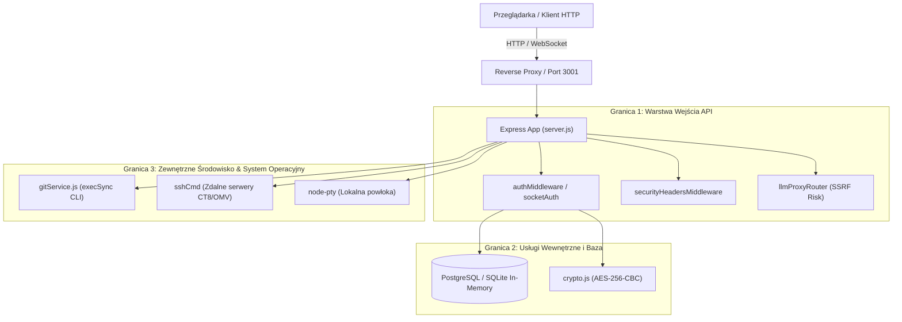

# Raport Audytu Bezpieczeństwa (Security Audit Report)

> **Data audytu:** 2026-10-30  
> **Aplikacja:** AI-Agents Dashboard (Express + React / Vite + Socket.IO + PostgreSQL)  
> **Standard:** OWASP Top 10 (2021) / OWASP LLM (2025) / STRIDE Threat Model

---

## 1. Podsumowanie Wykonawcze (Executive Summary)

Przeprowadzono pełny przegląd bezpieczeństwa aplikacji zgodnie ze standardem **OWASP Top 10** oraz metodyką **STRIDE**. Przeanalizowano konfigurację serwera Express, mechanizmy uwierzytelniania i autoryzacji, ochronę przed atakami SSRF, bezpieczeństwo wywołań powłoki (SSH / git CLI / process spawn), politykę nagłówków bezpieczeństwa oraz łańcuch dostaw (zależności npm).

### Wynik audytu zależności i jakości kodu:
- **`npm audit`**: **0 podatności** (stan czysty).
- **`oxlint`**: **0 błędów i ostrzeżeń** (kod spełnia reguły statycznej analizy).

### Zestawienie Zidentyfikowanych Podatności:
| ID | Podatność | Kategoria OWASP | Poziom ryzyka |
|:---|:---|:---|:---:|
| **SEC-01** | Bypassing uwierzytelniania przez `/api/socket-info` generujący 30-dniowy JWT bez logowania | A07: Identification and Auth Failures | **KRYTYCZNY** |
| **SEC-02** | Nieautoryzowany reset bazy administratorów przez `POST /api/auth/reset` | A01: Broken Access Control | **KRYTYCZNY** |
| **SEC-03** | Nieautoryzowany arbitralny SSRF w `/api/llm-proxy` przez nagłówek `x-target-url` | A10: Server-Side Request Forgery | **WYSOKI** |
| **SEC-04** | Ryzyko Command Injection w komendach Git (`gitService.js`) przez interpolację stringów w `execSync` | A03: Injection | **WYSOKI** |
| **SEC-05** | Brak nagłówków Content-Security-Policy (CSP) oraz HSTS w `securityHeadersMiddleware` | A05: Security Misconfiguration | **ŚREDNI** |
| **SEC-06** | Domyślny otwarty CORS (`cors()` z `*`) w Express i Socket.IO | A05: Security Misconfiguration | **ŚREDNI** |
| **SEC-07** | Ulotny klucz szyfrowania `ENCRYPTION_KEY` w `crypto.js` i brak wymogu długości w produkcji | A02: Cryptographic Failures | **ŚREDNI** |
| **SEC-08** | Akceptacja tokenu JWT w parametrach query string (`?token=...`) | A07: Identification and Auth Failures | **NISKI** |

---

## 2. Model Zagrożeń (STRIDE) i Granice Zaufania (Trust Boundaries)



### Macierz STRIDE:
1. **Spoofing (Podszywanie się):**
   - Każdy niezalogowany klient wywołujący `/api/socket-info` otrzymywał token z uprawnieniami `id: 1, isWorker: true`, który mógł podszyć pod dowolne wywołanie chronione `authMiddleware`.
2. **Tampering (Manipulacja danymi):**
   - Wywołanie `POST /api/auth/reset` bez autoryzacji usuwa całą tabelę `users`, co pozwala na przejęcie instancji (`check-setup` -> `POST /api/auth/setup`).
3. **Repudiation (Wypieralność):**
   - Brak logowania zdarzeń bezpieczeństwa przy operacjach destrukcyjnych i resetowaniu auth.
4. **Information Disclosure (Ujawnienie informacji):**
   - Użycie nagłówka `x-target-url` w proxy LLM pozwala skanować zasoby wewnętrzne (chmurowe meta-dane `169.254.169.254`, sieć lokalną OMV `10.10.10.100`, lokalne porty WSL).
5. **Denial of Service (Odmowa usługi):**
   - Brak limitu zapytań (rate limiting) na endpointach PTY oraz brak CSP.
6. **Elevation of Privilege (Eskalacja uprawnień):**
   - Parametry gałęzi / commitów przekazywane do `execSync` w `gitService.js` bez użycia `execFile` mogą prowadzić do wykonania poleceń w kontekście użytkownika procesu dashboardu.

---

## 3. Szczegółowy Opis Zidentyfikowanych Podatności

### 🔴 SEC-01: Bypassing autoryzacji przez `/api/socket-info`
- **Lokalizacja:** `server.js` (linie 409–428)
- **Problem:** Endpoint `/api/socket-info` używa `optionalAuthMiddleware`. Jeśli klient nie posiada tokenu, serwer generuje i zwraca 30-dniowy JWT z `{ id: 1, username: 'worker-client', isWorker: true }`. Ponieważ `authMiddleware` na `/api/*` sprawdza wyłącznie ważność podpisu JWT (`jwt.verify(token, JWT_SECRET)`), każdy nieautoryzowany użytkownik może pobrać token z `/api/socket-info` i uzyskać pełny dostęp do wszystkich endpointów `/api/*`!
- **Rekomendacja:** `/api/socket-info` musi wymagać pełnej autoryzacji (`authMiddleware`), a tokeny dla agentów roboczych powinny być wydawane tylko uwierzytelnionemu administratorowi.

---

### 🔴 SEC-02: Nieautoryzowany reset użytkowników przez `POST /api/auth/reset`
- **Lokalizacja:** `src/backend/auth/authRouter.js` (linie 143–151) oraz `src/Login.tsx` (linie 123–128)
- **Problem:** Endpoint `POST /api/auth/reset` wykonuje `DELETE FROM users` bez żadnego sprawdzenia uprawnień ani tokenu. Przycisk na ekranie logowania pozwala każdemu wyczyścić bazę użytkowników i zainicjalizować własne konto administratora.
- **Rekomendacja:** 
  1. Usunąć przycisk resetu z publicznego ekranu logowania w `Login.tsx`.
  2. Zablokować endpoint `POST /api/auth/reset` w środowisku produkcyjnym (`process.env.NODE_ENV === 'production'`) lub zabezpieczyć go silnym sekretnym kluczem serwisowym/hasłem administratora.

---

### 🟠 SEC-03: Arbitralny SSRF w `/api/llm-proxy` przez `x-target-url`
- **Lokalizacja:** `src/backend/llm/llmProxyRouter.js` (linie 11–24) oraz `server.js` (linia 453)
- **Problem:** `/api/llm-proxy` jest zamontowane przed `app.use('/api', authMiddleware)`. Router odczytuje nagłówek `x-target-url` i wykonuje zapytanie HTTP do dowolnego wskazanego adresu URL, przesyłając nagłówki i treść oraz zwracając odpowiedź do klienta.
- **Rekomendacja:**
  1. Dodać `authMiddleware` do `/api/llm-proxy`.
  2. Wprowadzić walidację adresu docelowego (whitelist hostów / schematów, blokada IP prywatnych i link-local typu `169.254.169.254`, `127.0.0.1`, `10.0.0.0/8`, `192.168.0.0/16`, `172.16.0.0/12`).

---

### 🟠 SEC-04: Potencjalne Command Injection w `gitService.js`
- **Lokalizacja:** `src/backend/git/gitService.js` (linie 115–250)
- **Problem:** Funkcje takie jak `commitChanges`, `checkoutBranch`, `createBranch`, `deleteBranch`, `stageFiles`, `pullChanges` budują ciągi poleceń powłoki przez interpolację stringów w `execSync`:
  ```javascript
  const cleanMsg = message.replace(/"/g, '\\"');
  execSync(`git commit -m "${cleanMsg}"`, execOpts);
  ```
  W powłoce `sh` / `bash` cudzysłowy nie zapobiegają ewaluacji `$(polecenie)` ani odwrotnych apostrofów (backticks).
- **Rekomendacja:** Zastąpić `execSync` z interpolacją ciągów bezpiecznym wywołaniem `execFileSync('git', ['commit', '-m', message], execOpts)` lub zwalidować parametry ściśle zdefiniowanym wyrażeniem regularnym (np. dla nazw gałęzi: `/^[a-zA-Z0-9._\-/]+$/`).

---

### 🟡 SEC-05: Brak nagłówków Content-Security-Policy (CSP) i HSTS
- **Lokalizacja:** `src/backend/utils/securityHeaders.js` (linie 10–17)
- **Problem:** Aplikacja definiuje `X-Frame-Options` i `X-Content-Type-Options`, ale nie ustawia `Content-Security-Policy` ani `Strict-Transport-Security`.
- **Rekomendacja:** Dodać nagłówek CSP ograniczający źródła skryptów i połączeń oraz HSTS (w środowisku HTTPS / produkcyjnym).

---

### 🟡 SEC-06: Otwarta konfiguracja CORS
- **Lokalizacja:** `server.js` (linie 110–113 oraz linia 337)
- **Problem:** `app.use(cors())` oraz Socket.IO `origin: '*'` akceptują zapytania z dowolnej domeny.
- **Rekomendacja:** W środowisku produkcyjnym ograniczyć dozwolone originy do skonfigurowanych domen (np. z `process.env.ALLOWED_ORIGINS` lub hosta wdrożenia CT8).

---

### 🟡 SEC-07: Ulotny i niekontrolowany `ENCRYPTION_KEY`
- **Lokalizacja:** `src/backend/utils/crypto.js` (linia 11)
- **Problem:** Jeśli `ENCRYPTION_KEY` nie jest ustawiony w `.env`, generowany jest losowy klucz w pamięci procesu. Po restarcie serwera wszystkie zaszyfrowane hasła SSH stają się nieodszyfrowywalne. Ponadto brak walidacji długości klucza w trybie produkcyjnym.
- **Rekomendacja:** Podobnie jak dla `JWT_SECRET`, weryfikować obecność i długość `ENCRYPTION_KEY` podczas startu w środowisku produkcyjnym.

---

### ⚪ SEC-08: Akceptacja tokenu JWT w query stringu
- **Lokalizacja:** `src/backend/auth/authMiddleware.js` (linia 14)
- **Problem:** `req.query.token` pozwala przekazywać tokeny JWT bezpośrednio w adresie URL. URL-e z tokenami mogą wyciekać do logów serwerów HTTP, nagłówków `Referer` i historii przeglądarek.
- **Rekomendacja:** Ograniczyć uwierzytelnianie wyłącznie do nagłówka `Authorization: Bearer <token>` lub ciasteczek `HttpOnly`.
